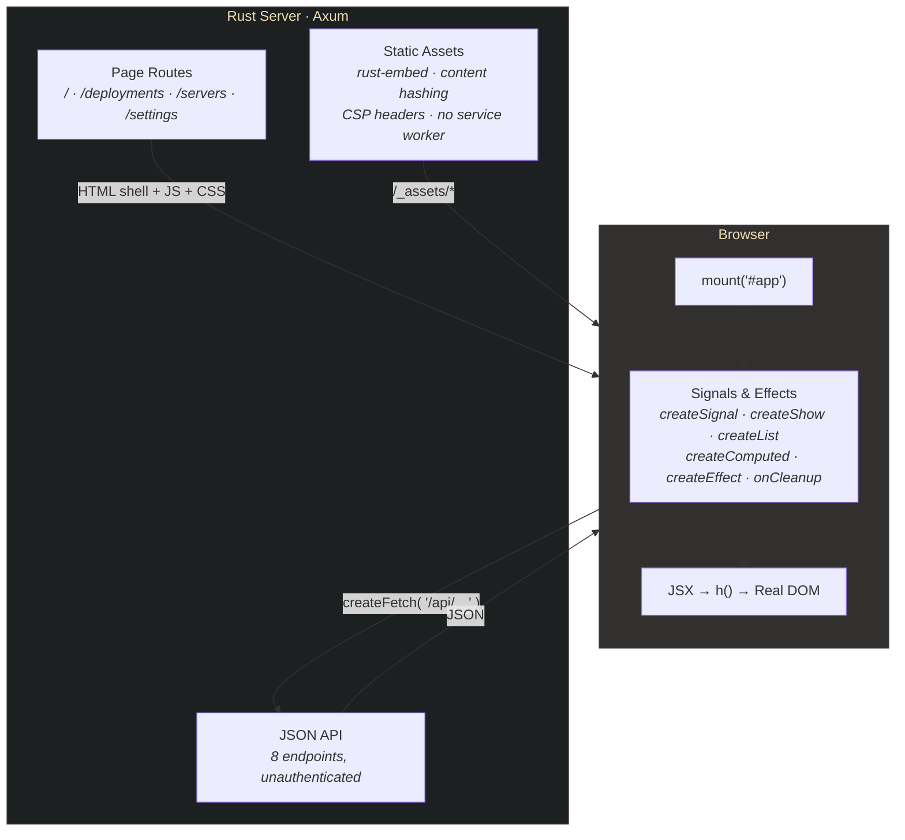

# FormaOps Dashboard

A DevOps admin panel built with the [Forma Stack](https://getforma.dev) — Rust +
FormaJS + Tailwind CSS. Everything interactive here — the SVG chart, the data
tables, the sidebar, the command palette — is built from FormaJS signals against
the real DOM. No React, no virtual DOM.

## Quick Start

```bash
# Build the frontend
cd admin && npm ci && npm run build && cd ..

# Start the Rust server
cargo run
```

Open [http://localhost:3000](http://localhost:3000).

`admin/package-lock.json` and `Cargo.lock` pin the versions this template was
built and tested with. `npm ci` installs exactly those and never rewrites the
lockfile; pnpm, yarn and bun do not read `package-lock.json` and resolve the
ranges in `package.json` afresh. `Cargo.toml` declares `rust-version = "1.85"`
with `resolver = "3"`, so a later `cargo update` only picks crates that still
build on Rust 1.85. Commit both lockfiles.

**`npm ci` reports 4 high advisories, all one chain, and there is nothing to
fix yet.** As of 2026-10-14, `admin/package-lock.json` resolves
`@tailwindcss/cli` 4.3.3 → `@parcel/watcher` 2.5.1 → `micromatch` 4.0.8 →
`braces` 3.0.3, and `braces` 3.0.3, the latest release (May 2024), is inside
[GHSA-vfj7-8cjw-p6xm](https://github.com/advisories/GHSA-vfj7-8cjw-p6xm)
(`<=3.0.3`: a stack-exhaustion denial of service through deeply nested brace
patterns; no fixed version on npm). `@parcel/watcher` is the file watcher
behind `@tailwindcss/cli --watch`, loaded only in that mode, which
`@getforma/build` never uses: it runs the Tailwind CLI once per build, so the
watcher never runs here, and nothing of it is in the built assets or the
server. `npm audit fix` changes nothing, because
`@tailwindcss/cli` 4.3.1 and later pin `@parcel/watcher` to exactly 2.5.1. The
chain clears when `@tailwindcss/cli` moves to `@parcel/watcher` 2.6.0, which
replaced `micromatch` with `picomatch`, or when `braces` publishes a fix;
`npm update @tailwindcss/cli` in `admin/` then picks it up.

## Security before you deploy this

The server binds to `127.0.0.1` (localhost only). To expose it, opt in:

```bash
FORMA_HOST=0.0.0.0 cargo run
```

**The `/api/*` routes have no authentication.** Every one of the eight endpoints
below answers any request that reaches the process. Today they return the mock
data in `src/data.rs`, so exposure costs you nothing — the moment you point them
at a real database, put authentication in front of them. The server prints a
warning at startup whenever `FORMA_HOST` is set to a non-loopback address.

**No service worker.** `main.rs` configures forma-server's worker setting off
(`sw::ServiceWorker::off()`), so no page registers one, and `/sw.js` serves
forma-server's retiring worker: a browser that installed a Forma worker on this
origin before deletes its caches and unregisters it on its next visit. The
worker is opt-in, per application; see `forma_server::sw` before turning it on.

**WebKit (Safari) logs one console error per page in a debug build:** "The
Content Security Policy 'require-trusted-types-for 'script'; trusted-types
forma forma-runtime' was delivered in report-only mode, but does not specify a
'report-to'". forma-server 0.2.2 sends Trusted Types in
`Content-Security-Policy-Report-Only` in development builds, and this template
names no reporting endpoint. It blocks nothing, and a release build sends no
Report-Only policy without an endpoint. The Playwright suite runs Chromium,
which logs nothing for it; a WebKit project that fails on console errors meets
it until the server names an endpoint it answers, for example
`PolicyExtensions::new().report_uri("/csp-reports")` on the `RenderCtx`
(`with_policy`) and a route that accepts the POST.

---

## What's Inside

### Pages

| Page | URL | What It Shows |
|------|-----|---------------|
| **Overview** | `/` and `/overview` | Stat cards, interactive SVG chart, service status grid, recent deployments, active incidents |
| **Deployments** | `/deployments` | 4 stat cards, searchable deployment history table with 12 rows, status/environment badges |
| **Servers** | `/servers` | Server fleet grid with status filter tabs (All/Online/Degraded/Offline), CPU/Memory/Disk progress bars |
| **Settings** | `/settings` | Placeholder card — yours to fill in |

### Features

- **Client-side routing** via `createSignal` + `createShow` + History API (no router library)
- **Command palette** (Cmd+K / Ctrl+K) with page search and navigation
- **Interactive SVG chart** — hand-rolled, hover tooltip with success/error counts
- **Deployment table search** — reactive filtering across all columns
- **Server fleet filtering** — `createComputed` filter with tab counts
- **Loading skeletons** and **error states** on every page
- **Collapsible sidebar** with grouped navigation and SVG icons
- **Dark theme** — Gruvbox palette with a neon green (#39FF14) accent
- **16 Playwright E2E tests** — navigation, data rendering, filtering, API validation, console-error check

### API Endpoints

| Route | Response | Description |
|-------|----------|-------------|
| `GET /api/metrics` | `Metric[]` | Overview stat cards (uptime, latency, load, deploy rate) |
| `GET /api/deployment-stats` | `DeploymentStats` | Deployments page stat cards |
| `GET /api/deployments` | `Deployment[]` | 12 deployment records |
| `GET /api/servers` | `Server[]` | 8 servers with CPU/memory/disk metrics |
| `GET /api/services` | `Service[]` | 8 services with health status and latency |
| `GET /api/service-summary` | `ServiceStatusSummary` | Aggregate counts (healthy/degraded/down) |
| `GET /api/request-volume` | `RequestVolumePoint[]` | 24 hourly data points for the SVG chart |
| `GET /api/incidents` | `Incident[]` | 5 incidents with severity and status |

---

## Layout

```
src/
├── main.rs                    Axum server — page routes + 8 API routes
└── data.rs                    Structs and mock data (replace with your DB)

admin/src/
├── app.tsx                    Layout, Sidebar, TopBar, routing, command palette
├── pages/                     OverviewPage, DeploymentsPage, ServersPage, SettingsPage
├── components/                Icon, icons.ts, StatCard, StatusBadge, ProgressBar, UserAvatar
└── styles/dashboard.css       Tailwind v4 @theme + custom animations
```



---

## Phase 1 by design

This template is **client-rendered**, and that is a decision rather than an
oversight. The server sends `<div id="app"></div>` plus a script tag; a nonce'd
`personality_css` rule paints the dark background immediately so there is no
white flash, and the layout appears once the JS runs.

Turning SSR on here makes the page worse, and it is worth understanding why,
because the same rule decides how *your* pages will behave:

- The FMIR compiler walks source, it does not run it. It can translate literal
  JSX and a component call it can follow and prove; it cannot translate a
  `.map()` over data that does not exist yet, a component handed a value only
  the running program knows, or a dynamic tag. Anything it cannot translate
  becomes an island placeholder — an empty `<div data-forma-island="…">` with
  no content, which for the anonymous ones (`island_7`) has no registry entry
  either, so nothing can hydrate it.
- This dashboard renders data fetched at runtime from its own `/api/*` routes,
  on every page: `.map()` over a fetched array, `<StatCard value={m.value}/>`,
  `<StatusBadge status={d.status}/>`. That is the shape that cannot be proven.
- Serve it as Phase 2 and FormaJS tries to adopt a DOM whose content is
  missing. Measured on this template: **14 of the 16 Playwright tests fail**,
  against 16/16 passing in Phase 1.

**Measurements, dated — the numbers move with the compiler, the rule does not.**

| Measured | Compiler | IR emitted | Named signal slots | Islands | Playwright, Phase 2 |
|---|---|---|---|---|---|
| earlier | published `@getforma/compiler` 0.2.0 (what this template pinned then; it pins no compiler since its pages are browser-rendered by declaration) | 605 B of empty shells | — | all anonymous | 2 of 16 |
| 2026-08-06 | `forma-tools` `[Unreleased]` — the resolver fixes, published that day as `@getforma/compiler` 0.3.0 | 14856 B | 3 of 90 | 64, of which **27 named** (`Icon` ×15, `StatCard` ×4, `ProgressBar` ×3, `StatusBadge` ×2, `UserAvatar`, `RequestVolumeChart`, `formatDuration`) and 37 anonymous | 2 of 16 |

The second row is the interesting one. Those compiler fixes are real
defects — `.tsx` pages no longer compile to a placeholder, components imported
by a page file resolve, islands carry their real names — and the sidebar, top
bar and layout genuinely arrive as server-rendered markup. The page *content*
still does not, because it is not knowable at compile time, and the Playwright
number does not move. Fixing resolution was necessary and is not sufficient.

So the browser route is a declaration on both sides: `build.ts` declares the
dashboard's entry `ssr: false`, `main.rs` serves every page through
`render_browser_shell`, and there is no `build:ssr` script to reach for by
mistake. The server never walks a module here, so no failed server render can
quietly become a client-mounted page. If you do wire SSR up yourself for a
page, render it with `try_render`: a failure comes back to the handler as a
coded `RenderError`, which it logs through the `tracing` subscriber `main.rs`
installs and answers with an error page.

The build scripts pass `--strict`, which `build.ts` maps to `@getforma/build`'s
`strict: true`. It changes nothing while no page is server-rendered; once one
is, a construct the compiler cannot render on the server fails the build with
its code, file and line instead of becoming an empty island.

**Want to see Phase 2 working?** Scaffold the `minimal` template
(`npx @getforma/create-app my-app --template minimal`). It keeps its page shell
as literal JSX, so `npm run build:ssr` emits real IR (0 islands) and the server
sends real markup that the client adopts.

**Want the rule rather than the anecdote?** The numbers above were measured
against this template as shipped, with the compiler version its `package.json`
pins. The underlying rule — what the compiler can and cannot prove, and how to
build a page that server-renders — is written up in
[RENDERING-PHASES.md](https://github.com/getforma-dev/create-forma-app/blob/main/docs/RENDERING-PHASES.md),
and the authoritative list of translatable constructs is *What renders
server-side* in
[the compiler's README](https://github.com/getforma-dev/forma-tools/blob/main/packages/compiler/README.md).

---

## FormaJS Patterns Used

Full API documentation lives at [getforma.dev/docs](https://getforma.dev/docs);
this is a map of where each primitive shows up in this codebase.

| Primitive | Where | What it does here |
|---|---|---|
| `createSignal` | `app.tsx`, every page | Current page, sidebar collapse, search text, filter tab |
| `createShow` | `app.tsx`, every page | The router itself, plus loading/error branches |
| `createList` | `DeploymentsPage`, `ServersPage` | Keyed table rows and server cards |
| `createComputed` | `ServersPage` | Filtered fleet + per-status counts |
| `createEffect` | `app.tsx`, `OverviewPage` | URL sync via History API; imperative SVG hover layer |
| `onCleanup` | `app.tsx` | Removes the `popstate` and `keydown` listeners |
| `createFetch` | every page | Loads `/api/*` with `.data()` / `.loading()` / `.error()` |

Two things that catch people out:

- **`createFetch` is imported from `@getforma/core/http`**, not the main entry.
  The core bundle contains no network code.
- **Reactive props are functions.** `class={() => ...}` re-runs on signal change;
  `class={...}` is evaluated once.

### Styling

Tailwind CSS v4 with a `@theme` block in `admin/src/styles/dashboard.css` (v4
has no `tailwind.config.js`), which is what gives you `bg-gruvbox-bg-soft`,
`text-forma-green` and friends. Custom CSS is limited to the neon glow,
`@keyframes`, and scrollbar styling.

Note how the CSP the server sends treats styles. `style-src` carries a nonce
and no `unsafe-inline`, so inline `<style>` blocks and third-party stylesheets
are refused. A separate `style-src-attr 'unsafe-inline'` permits `style="..."`
attributes specifically, which is what lets server-rendered style attributes
through. The `style={...}` props in this template do not rely on that: `h()`
applies them through the CSSOM at runtime, which CSP does not cover at all.

---

## Customising

- **Real data:** edit `src/data.rs` — replace the hardcoded `Vec<...>` returns
  with your queries. The structs are the API contract, and `serde` derives the
  JSON.
- **A new page:** add `admin/src/pages/MyPage.tsx`, a `createShow` branch in
  `app.tsx`, entries in `PAGE_META` / `PALETTE_ITEMS` / the sidebar, and a route
  in `main.rs` (page routes all render the same shell — the client routes).
- **Icons:** copy path data from [Iconify Lucide](https://icon-sets.iconify.design/lucide/)
  into `components/icons.ts`, then `<Icon d={ICON_NAME} />`.

## Tests

```bash
cd admin && npx playwright install chromium   # first run only
npm test
```

16 tests. `playwright.config.ts` starts the server for you with
`cd .. && cargo run`, so build the frontend first.

## Tech Stack

| Layer | Technology |
|-------|-----------|
| Server | Rust + Axum, `forma-server` for page rendering, assets and CSP |
| Frontend | FormaJS (`@getforma/core`) — signals, JSX via `h()` |
| Styling | Tailwind CSS v4 |
| Build | `@getforma/build` + esbuild — bundling, hashing, compression, manifest |
| Assets | `rust-embed` (read from disk in debug builds, embedded in release) |
| Testing | Playwright |

## Part of the Forma Stack

- [@getforma/core](https://www.npmjs.com/package/@getforma/core) — reactive DOM library
- [@getforma/build](https://www.npmjs.com/package/@getforma/build) — build pipeline
- [@getforma/compiler](https://www.npmjs.com/package/@getforma/compiler) — FMIR compiler (used by the `minimal` template's SSR build)
- [forma-server](https://crates.io/crates/forma-server) — Rust page rendering, assets, CSP
- [forma-ir](https://crates.io/crates/forma-ir) — FMIR parser and HTML walker
