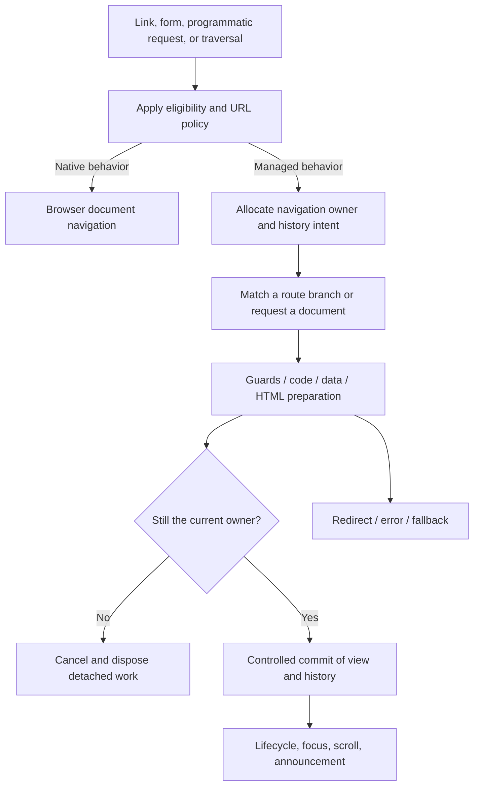

# Three routing systems, three different sets of responsibilities

Snapshot: 2026-10-26. The detailed source citations and caveats are in the
[Angular](research/angular/report.md), [Astro](research/astro/report.md), and
[React Router](research/react-router/report.md) reports. This comparison is a
synthesis of those pinned implementations and our retained observations.

## What is actually running on the documentation sites?

| Site | Source ownership | Selected observed navigation with JavaScript | Transport observed after click | JavaScript disabled |
| --- | --- | --- | --- | --- |
| angular.dev | `angular/angular`, router under `packages/router`, site under `adev` | Same document; Navigation API events, no wrapped `pushState` call in the sample | `assets/content/guide/routing/define-routes.md.html` fetch | Full document navigation; content available |
| docs.astro.build | `withastro/docs`, theme `withastro/starlight`; framework `withastro/astro` | Full document navigation | Destination HTML document plus assets | Full document navigation; content available |
| reactrouter.com | `remix-run/react-router` library/content; `remix-run/react-router-website` application | Same document; `pushState` observed | `/start/modes.data` fetch | Full document navigation; content available |

These are measured samples, not predictions based on branding. Evidence:
[Angular](evidence/browser-angular.json), [Astro](evidence/browser-astro.json),
[React Router](evidence/browser-react-router.json). Chromium was
155.0.8059.85, with fresh contexts and both JavaScript settings. The script
records time origin, document marker, history/navigation events, headings,
request types, and Back navigation. React Router was rechecked with an explicit
heading wait after an initial snapshot caught an unsettled Back transition;
the [initial record](evidence/browser-react-router-initial.json) is preserved.

Astro's documentation site is especially important: its optional ClientRouter
exists and is analyzed from the published package, but the sampled docs page
does not enable it. Prefetching, persisted sidebar settings, or a visual
transition alone do not prove that a document stayed alive.

## Router model comparison

| Concern | Angular Router, pinned 22.2.3-era source | Astro ClientRouter, 7.2.10 | React Router, 8.5.0 |
| --- | --- | --- | --- |
| Primary model | URL tree → activated route tree → outlets/components | URL → server-produced HTML → prepared document swap | URL → ranked route branch → React outlet tree; optional data coordinator |
| Route precedence | Configuration order; first successful full recognition, including child recognition and `canMatch` | File-route precedence belongs to build/server; client asks server for next document | Default ranked branch matcher; experimental route-pattern matcher is separate |
| URL representation | Segment groups, primary/named outlets, matrix/query params, fragment | Browser URL; HTML server owns page identity | Pathname/search/hash, basename, params, relative route context |
| Initial page | Angular bootstrap/SSR hydration as configured | Full HTML document and optional islands | CSR, SSR hydration, or prerender according to mode |
| Client update | Component activation/reuse; site may load content fragments inside components | Head/root/body reconciliation with explicit persistence and scripts | Router state commits; React reconciles matched outlets |
| Data | Guards, resolvers, configurable rerun policies; preview resources are distinct | Default loader fetches HTML; preparation loader is extensible | Declarative app-owned; Data/Framework loaders/actions/fetchers and revalidation |
| Concurrency | Transition switching, navigation IDs, abort and continuation checks | Abort preparation, wait preceding DOM update, recheck ownership | Abort requests, check aborted results; load IDs for intersecting fetcher/revalidation work |
| History | Traditional HistoryStateManager and experimental Navigation API path | Indexed history state and outgoing-location tracking | Router key/index/user state; commit PUSH/REPLACE, treat POP separately |
| Preservation | RouteReuseStrategy and outlet ownership | Explicit persistent DOM nodes and island lifecycle protocol | React component identity determined by route tree/reconciliation |
| Script behavior | Runtime/modules own execution; docs viewer has its own content handling | Script deduplication and controlled re-execution are central | Bundled modules and React lifecycle; not arbitrary script replay from fetched HTML |
| Completion | Multiple events and phases; activation cannot be interrupted arbitrarily | DOM update, animation, scripts/page-load are different completion points | Data/navigation state, React rendering and optional transition completion differ |

The similarities are useful, but none of these contracts is interchangeable with
another merely because an address bar changes without a reload.

## The common algorithm beneath the frameworks

This diagram is an original abstraction, not a claim that every framework uses
exactly these phases in this order. Its value is identifying the decisions a
reconstruction must make explicitly.

**The committed view is not the pending target.** While a request is loading,
the old view can remain usable. A Back/Forward event can already have changed
the browser URL while the displayed view is still old. Keep those identities
separate. Otherwise relative links, scroll snapshots, cancellation, and error
recovery are evaluated against the wrong page.

**Abort reduces wasted work; ownership prevents stale commits.** An application
loader may ignore its signal. An old promise may settle after a newer request.
An animation callback may run after a user clicks elsewhere. Check the current
navigation record at asynchronous boundaries, and dispose work that lost its
owner. The [reference kernel](reference-router/kernel.mjs) tests that property
without pretending to reproduce each upstream scheduling system.

**Reuse requires a lifecycle model.** Keeping a header is easy. Preserving a
component with signals, subscriptions, a worker, listeners, media, or hydration
state requires an owner and a disposal/persistence contract. Astro's temporary
node moves are particularly revealing: a disconnect does not always mean the
component has permanently left the page.

## Decisions that cannot be hidden behind a shared API

### Route selection

An Angular-style ordered tree and a React-Router-style ranked tree can choose
different winners for the same configuration. Astro's client navigator can
avoid route-table matching entirely by asking the server. A new router must
choose one model, document ambiguity and invalid syntax, and test it. The
prototype offers deliberately small ordered/ranked modes to expose the choice;
its scoring is not React Router's exact score and its grammar is not Angular's.

### Mutations and revalidation

React Router's actions/fetchers define data refresh behavior that a simple link
navigator does not supply. Angular resolvers and Astro HTML preparation are not
synonyms for actions. A cancelled client request cannot promise an already
processed server mutation was undone. A document-navigation fallback after a
POST can repeat a mutation unless its contract prevents resubmission. The Astro
report calls out the relevant POST-specific branch.

### Caching and prefetch

The docs app's Angular content-promise cache, Astro's attempted-prefetch URL set,
the HTTP cache, React Router loader reuse, and Forma's in-flight prefetch sharing
solve different problems. A URL key alone may omit authentication, locale,
release, query, or headers that influence the representation. Choose retention,
invalidation, failure eviction and concurrency ownership before adding a cache.
No benchmark here establishes which framework is faster.

### History and browser APIs

The History API changes session history; the application still owns view work.
The Navigation API offers a navigation event and interception/lifecycle tools,
but support and application feature selection remain explicit. In this snapshot,
Angular docs opt into an experimental path when available and exclude Firefox.
The React Router sample emits Navigation API events too because browser history
operations produce them; those events alone do not prove that React Router used
Navigation API interception. The wrapped History calls and source configuration
are the additional evidence. [HTML navigation/history standard](https://html.spec.whatwg.org/multipage/nav-history-apis.html).

### Accessibility and transitions

A preserved document does not get the full browser page-load experience for
free. Title changes, focus, scroll, route announcements, reduced motion and
loading feedback are separate policies. Astro protects focus inside persisted
subtrees and announces routes; that is different from always focusing a new h1.
React Router allows application decisions around focus/announcements. An
animation's finished promise, a DOM-update promise, and data readiness should
not be used interchangeably.

## What REA contributed, and what it did not

REA recovered static import/export relationships, locations, possible routing
strings and explicit coverage information from the captured JavaScript. The
Angular graph includes substantial retained findings but hits semantic-node
bounds. The small Astro artifacts reveal module relationships and prefetch
behavior when read alongside source. React Router's small chunks are tractable;
its large entry chunk timed out under the selected budget, and its route-string
inventory did not recover the application route table. Parsing the inert build
manifest supplied that table instead.

This is why the research keeps four methods separate: official API intent,
pinned implementation, shipped artifact analysis, and observed interaction.
Agreement strengthens a conclusion; disagreement or missing coverage remains
visible in the reports. No tool in this study proves private backend internals,
complete runtime reachability, or untested cross-browser behavior.
