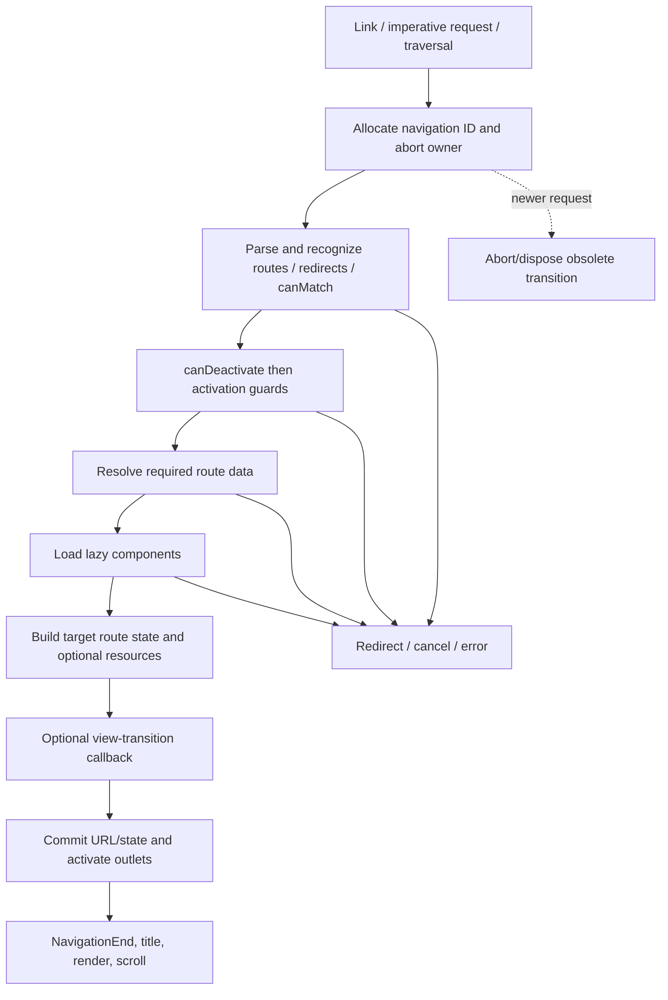

# Angular client-side routing: library, docs app, and shipped evidence

Research date: **2026-10-26**. Primary requested page: [Angular routing](https://angular.dev/guide/routing). This report distinguishes the Angular Router library from the `angular.dev` application built on it.

## What was identified

Both implementations live in **[angular/angular](https://github.com/angular/angular)**. The router owns `packages/router`; the documentation application owns `adev`. The live page footer reported **v22.2.3+sha-ecaec13**. The GitHub commit endpoint resolved that prefix to **`ecaec13db4fde7ceb0104105ee356bf00596f3d6`**, which is the exact source snapshot retained locally. This is the site's self-reported build identity, corroborated by source and shipped-bundle features. It is not a reproducible build attestation or proof that every deployed byte equals that Git commit.

The docs application is pre-rendered, hydrates Angular, and then uses its router. Its repository contains a Firebase Hosting configuration with an `angular-docs` target, `build/browser` output, immutable hashed assets, and a catch-all `index.html` rewrite. That establishes the intended deployment configuration, not a fresh account-level inventory of the live host. [A29](https://github.com/angular/angular/blob/ecaec13db4fde7ceb0104105ee356bf00596f3d6/adev/src/app/app.config.ts#L30-L59) [A33](https://github.com/angular/angular/blob/ecaec13db4fde7ceb0104105ee356bf00596f3d6/adev/firebase.json#L1-L86)

**Core finding:** Angular is a route-tree and component-lifecycle router. The docs app additionally implements a content-fragment viewer inside that component system. It does not use a general full-document HTML swap for each client transition. Its current source can use the browser **Navigation API**, not only the older History API.

## Evidence and how to read it

| Label | Meaning in this report |
| --- | --- |
| Source-derived | Read from exact pinned TypeScript/configuration, with source links. Behavior has not automatically been executed. |
| REA-observed | REA 6.8.0 parsed downloaded shipped JavaScript without running it. Graph edges are static relationships, not proof of execution. |
| Browser-observed | A specific public link navigation was exercised in Chromium 155, with document identity and request evidence. |
| Reconstruction recommendation | Our design conclusion, not an Angular compatibility promise. |

The routing-guide Markdown sources are retained alongside the implementation; the manifest maps all 18 guide files to their official page URLs and exact source hashes. The full provenance is in [sources.json](sources.json), the source map in [source-index.md](source-index.md), and bounded REA output summaries in [rea-summary.json](rea-summary.json). Full downloaded artifacts, repository source, stdout evidence, stderr, and command receipts remain under the project's `.local` directory.

### The actual browser observation

The parent investigation tested `/guide/routing` → `/guide/routing/define-routes` in Chromium **155.0.8059.85** on October 26. With JavaScript enabled, the document ID and performance time origin stayed unchanged, the H1/title changed, and the navigation made **two requests**, neither a document request: the generated `define-routes.md.html` content and its diagram image. The instrumentation saw a Navigation API `push` event; wrappers around `history.pushState`/`replaceState` saw no new calls. Back produced a `traverse` event and returned to the original heading in the same document with no new requests in this sample. With JavaScript disabled, the same link fetched a new document and had a new time origin. See [browser-angular.json](../../evidence/browser-angular.json).

These results establish this sampled route's client navigation and useful no-JavaScript fallback. They do not establish all browsers, every navigation mode, scroll restoration from nonzero positions, or cancellation behavior under held network requests. Focus was recorded on `BODY` in this sample; an accessible-heading focus policy must not be inferred from the title change alone.

## 1. The URL model is a tree, not a path split

Angular parses a URL into a `UrlTree`: a root `UrlSegmentGroup`, child groups keyed by outlet name, per-segment matrix parameters, a separate query-parameter map, and a fragment. `DefaultUrlSerializer.parse` constructs this model; serialization is the reverse structural operation. Auxiliary/named outlets are why parentheses and outlet separators belong to the grammar. A flat `/` splitter cannot reproduce it. [A01](https://github.com/angular/angular/blob/ecaec13db4fde7ceb0104105ee356bf00596f3d6/packages/router/src/url_tree.ts#L472-L498)

Encoding is contextual: path segments/matrix values, query values, and fragments have different escaping rules. Query parsing treats `+` as a space and preserves repeated keys as arrays. Encoded `/` belongs to a decoded segment value in the default serializer rather than automatically becoming a new path separator. User-derived map keys need explicit safe handling: repeated query values use own-property checks, and named-outlet dictionaries have null prototypes so an outlet named `__proto__` remains ordinary data. A separate helper limits oversized V8 indexed-property backing stores for numeric keys. [A02](https://github.com/angular/angular/blob/ecaec13db4fde7ceb0104105ee356bf00596f3d6/packages/router/src/url_tree.ts#L572-L642) [A35](https://github.com/angular/angular/blob/ecaec13db4fde7ceb0104105ee356bf00596f3d6/packages/router/src/url_tree.ts#L643-L662) [A38](https://github.com/angular/angular/blob/ecaec13db4fde7ceb0104105ee356bf00596f3d6/packages/router/src/url_tree.ts#L810-L884)

A crucial site-specific override is `AdevUrlSerializer`: it replaces `%2F`/`%2f` with `/` **before** calling the default parser, because the application's host is described as doing that decoding. This avoids server/client disagreement at hydration. It is not the generic Angular Router contract and should not be copied as a universal decoder. See [the exact short excerpt](snippets/url-parser-host-alignment.excerpt.ts). [A30](https://github.com/angular/angular/blob/ecaec13db4fde7ceb0104105ee356bf00596f3d6/adev/src/app/core/services/routing/adev-url-serializer.ts#L15-L25)

**Reconstruction consequence:** define URL grammar and normalization separately from route matching. Preserve query repetition, fragments, encoded values, base paths, and host normalization. Add round-trip fixtures. If the proposed router does not support matrix parameters or named outlets, explicitly leave them out rather than partly interpreting Angular syntax.

## 2. Matching is ordered recognition of a complete route branch

`Recognizer.processSegment` tries routes in configuration order. It returns when one successfully recognizes; `NoMatch` allows the next route to be tried. A matching prefix whose children cannot consume the remainder is not necessarily the final winning route. Therefore “first match wins” means the first successful recognition path, not merely the first prefix regex. [A04](https://github.com/angular/angular/blob/ecaec13db4fde7ceb0104105ee356bf00596f3d6/packages/router/src/recognize.ts#L251-L284)

The route matcher consumes URL segments and produces positional parameters and remaining segments. An empty path can consume none; `pathMatch: 'full'` rejects leftover path/children. The pinned default matcher supports a single `**` wildcard position, including prefix/suffix matching; do not assume every Angular generation has exactly this implementation. `canMatch` runs during recognition after a structural match; a false result makes the candidate fail so other configurations can be tried. A redirect result is different from a false result. [A05](https://github.com/angular/angular/blob/ecaec13db4fde7ceb0104105ee356bf00596f3d6/packages/router/src/utils/config_matching.ts#L54-L118) [A06](https://github.com/angular/angular/blob/ecaec13db4fde7ceb0104105ee356bf00596f3d6/packages/router/src/shared.ts#L153-L218)

Recognition handles children and named outlets, puts the primary outlet first for redirect precedence, and merges compatible empty-path results. A successful match becomes an `ActivatedRouteSnapshot` tree. That structure provides parent/child route context, outlet placement, static/resolved data, and later reuse decisions.

Redirects transform URL trees and may restart recognition. Absolute restarts are bounded: this pinned implementation counts them against `MAX_ALLOWED_REDIRECTS = 31`; beyond that limit it throws in development mode and disables further redirects in production. Redirects are not ordinary successful component activation. [A03](https://github.com/angular/angular/blob/ecaec13db4fde7ceb0104105ee356bf00596f3d6/packages/router/src/recognize.ts#L120-L172)

**Reconstruction consequence:** choose explicit precedence. Ordered routes and specificity-scored branches are different contracts. Add tests for `/users/new` versus `/users/:id`, unmatched children, empty parents, wildcard behavior, redirect loops, relative redirects, and encoded parameters. See the [first-successful-recognition excerpt](snippets/first-successful-recognition.excerpt.ts).

## 3. Navigation is a cancellable transaction

A navigation carries an ID, raw/extracted/final URL trees, trigger, extras, current and target snapshots, promise resolution handlers, and an abort signal. The pipeline is observable, but its logic is more than “fetch then set HTML.” [A08](https://github.com/angular/angular/blob/ecaec13db4fde7ceb0104105ee356bf00596f3d6/packages/router/src/navigation_transition.ts#L447-L985)

The outer `switchMap` abandons a previous transition when a newer one arrives. The implementation also compares IDs because synchronous re-entrant callbacks can create a third navigation while the second is cancelling the first. A `shouldContinueNavigation()` check prevents an obsolete callback from committing further side effects. This is a useful general pattern: cancellation signals reduce work; **ownership checks protect correctness** when work or callbacks cannot be stopped. [A08](https://github.com/angular/angular/blob/ecaec13db4fde7ceb0104105ee356bf00596f3d6/packages/router/src/navigation_transition.ts#L447-L985)

The pipeline exposes `NavigationStart`, route recognition, guard, resolver, activation, cancellation/error, and `NavigationEnd` events. Same-URL navigation can be skipped unless reload is requested. An unsupported navigation need not look like a success. Resolver completion without a value yields a specific cancellation path; redirects have separate handling from errors. Finalization aborts pending work and settles state. Activation is deliberately a non-abortable phase once entered; its observable boundary is not an arbitrary point for asynchronous interruption. [A08](https://github.com/angular/angular/blob/ecaec13db4fde7ceb0104105ee356bf00596f3d6/packages/router/src/navigation_transition.ts#L447-L985)

**Reconstruction consequence:** keep a single current transition record. After every await or callback that can re-enter, validate that the record still owns the commit. Define terminal results such as success, skipped, cancelled, redirected, and failed. A loading indicator must react to the terminal result of its own navigation, not whichever promise settles last.

## 4. Guards and data loading have distinct contracts

`canMatch` participates in recognition. `canDeactivate` checks the branch being left; activation checks follow for the destination branch, including child guards. A false activation/deactivation guard cancels navigation; a URL tree or redirect command routes through the redirect machinery. Guard priority is deterministic despite asynchronous values. These are browser-side workflow controls, not a replacement for server authorization. [A05](https://github.com/angular/angular/blob/ecaec13db4fde7ceb0104105ee356bf00596f3d6/packages/router/src/utils/config_matching.ts#L54-L118) [A12](https://github.com/angular/angular/blob/ecaec13db4fde7ceb0104105ee356bf00596f3d6/packages/router/src/operators/check_guards.ts#L56-L171)

Traditional resolvers run only for the routes selected by the guards/resolver policy. Routes are processed in an ordered traversal so inherited data is available to descendants. Resolver keys **within one route** use concurrent merging; route-level processing uses `concatMap`. A broad claim that “all Angular data loaders run in parallel” would be wrong for this resolver path. Each resolver is consumed for its first value; no emitted value cancels the transition. A resolver can redirect. [A13](https://github.com/angular/angular/blob/ecaec13db4fde7ceb0104105ee356bf00596f3d6/packages/router/src/operators/resolve_data.ts#L28-L126)

Re-running data is separately configurable through `runGuardsAndResolvers`. The default `paramsChange` compares params/URL segments rather than all query-only changes. Available policies include always, path-parameter changes, and query-inclusive variants. Recreating a component does not automatically mean all guards/resolvers rerun. [A19](https://github.com/angular/angular/blob/ecaec13db4fde7ceb0104105ee356bf00596f3d6/packages/router/src/utils/preactivation.ts#L176-L205) [A15](https://github.com/angular/angular/blob/ecaec13db4fde7ceb0104105ee356bf00596f3d6/packages/router/src/route_reuse_strategy.ts#L117-L165)

The pinned version also has **route resources in developer preview**, enabled with `withRouterResources()`. This path integrates reactive resource objects, can wait for blocking resources across matched routes concurrently, and allows explicit non-blocking resources. It is a distinct facility from traditional resolver behavior and appears after target-state construction in the pipeline. The inspected docs-app provider list does **not** enable it. [A20](https://github.com/angular/angular/blob/ecaec13db4fde7ceb0104105ee356bf00596f3d6/packages/router/src/provide_router.ts#L906-L956) [A21](https://github.com/angular/angular/blob/ecaec13db4fde7ceb0104105ee356bf00596f3d6/packages/router/src/operators/setup_and_run_resources.ts#L28-L215) [A22](https://github.com/angular/angular/blob/ecaec13db4fde7ceb0104105ee356bf00596f3d6/adev/src/app/routing/router_providers.ts#L32-L89)

**Reconstruction consequence:** separate matching, permission/workflow decisions, data execution, render identity, and revalidation. Otherwise a query change, a component reuse decision, and an API refresh accidentally become the same operation. A simple docs navigator may need only one content loader; a general app router needs a documented loading/revalidation contract.

## 5. Browser history has two implementations here

### The regular History API path

`HistoryStateManager` listens for `popstate` through Angular `Location`. A traversal is fed into the same router machinery with replace semantics; it must not append a fresh history entry. The manager snapshots committed state, writes URLs either eagerly after recognition or deferred just before activation, and uses `replaceState` for replacement/same-path navigation or `go` for a new entry. It combines application-provided state with router navigation/page IDs. [A09](https://github.com/angular/angular/blob/ecaec13db4fde7ceb0104105ee356bf00596f3d6/packages/router/src/statemanager/state_manager.ts#L193-L325)

If a guard or render preparation fails after a history movement, the manager restores browser/router consistency. Under `canceledNavigationResolution: 'computed'`, page-index differences can drive `historyGo` in the opposite direction. Under the replace mode, the existing entry is repaired. This is why a blocked Back action is harder than a blocked link click: the browser may already have moved its history cursor. [A09](https://github.com/angular/angular/blob/ecaec13db4fde7ceb0104105ee356bf00596f3d6/packages/router/src/statemanager/state_manager.ts#L193-L325)

### The current docs site's optional Navigation API path

The docs providers feature-detect `window.navigation`, exclude Firefox in this snapshot, and enable `withExperimentalPlatformNavigation()`. They also configure computed cancellation handling. The exclusion has a specific upstream browser-issue explanation in the source; its current necessity should be rechecked before future adoption. [A22](https://github.com/angular/angular/blob/ecaec13db4fde7ceb0104105ee356bf00596f3d6/adev/src/app/routing/router_providers.ts#L32-L89) [A36](https://github.com/angular/angular/blob/ecaec13db4fde7ceb0104105ee356bf00596f3d6/packages/router/src/provide_router.ts#L195-L270)

`NavigationStateManager` actually listens for `navigate`, calls `event.intercept`, connects the event's abort signal to the router, preserves reload/download/cross-boundary navigation, and coordinates precommit support where available. The source contains an outdated introductory comment suggesting only partial popstate integration, but the actual implementation below it is substantially more complete. Our conclusion follows the executable paths, not that comment. [A10](https://github.com/angular/angular/blob/ecaec13db4fde7ceb0104105ee356bf00596f3d6/packages/router/src/statemanager/navigation_state_manager.ts#L117-L239) [A11](https://github.com/angular/angular/blob/ecaec13db4fde7ceb0104105ee356bf00596f3d6/packages/router/src/statemanager/navigation_state_manager.ts#L402-L541)

When it can use a deferred precommit handler, the manager resolves browser commitment at the appropriate router phase and can redirect with correct push/replace semantics. It coordinates successful completion after rendering to allow browser focus/scroll behavior. The browser experiment's `push`/`traverse` events and absence of wrapped History API calls are consistent with this branch in Chromium 155. They do not establish identical behavior in Firefox, Safari, or older Chromium.

**Reconstruction consequence:** isolate the browser-navigation adapter from the route transaction. A History API baseline and an optional Navigation API adapter can share recognition, guards, data, and rendering. Do not mix their state objects or assume that every navigation enters through a document click listener.

## 6. Links retain normal browser affordances

`RouterLink` maintains a real href. For anchor-like elements it leaves non-primary clicks, modifier clicks, and non-`_self` targets to the browser. Otherwise it builds a URL tree, calls `navigateByUrl`, and prevents normal anchor navigation. It is a directive contract, not a universal listener attached to every arbitrary `<a>` on the page. [A07](https://github.com/angular/angular/blob/ecaec13db4fde7ceb0104105ee356bf00596f3d6/packages/router/src/directives/router_link.ts#L480-L533)

The docs viewer has a separate listener setup for anchors inside generated HTML. It checks origin, preserves modifier behavior via its helper, and avoids routing an in-page anchor when the target exists. It rewrites fragment-only links because `<base href="/">` changes resolution. This helper's detailed edge behavior is not identical to `RouterLink`; for example its target comparison literally uses `self`, and the absolute-link conversion assembles path/hash/search in that order. Those details are source observations, not patterns we recommend copying without dedicated tests. [A24](https://github.com/angular/angular/blob/ecaec13db4fde7ceb0104105ee356bf00596f3d6/adev/shared-docs/utils/navigation.utils.ts#L94-L152) [A27](https://github.com/angular/angular/blob/ecaec13db4fde7ceb0104105ee356bf00596f3d6/adev/shared-docs/components/viewers/docs-viewer/docs-viewer.component.ts#L355-L399)

The Navigation API manager independently excludes reloads, download requests, non-interceptable events, and paths outside the app base. Link eligibility and browser interception are therefore both part of the effective behavior. [A11](https://github.com/angular/angular/blob/ecaec13db4fde7ceb0104105ee356bf00596f3d6/packages/router/src/statemanager/navigation_state_manager.ts#L402-L541)

## 7. What actually changes in the DOM

Angular creates an activated route state, compares future/current route configurations, and activates or reuses outlet components. Its base reuse strategy reuses a route when `future.routeConfig === current.routeConfig`. This allows parameter/query/fragment changes without necessarily destroying the component. By default it does not store detached routes for later restoration. Custom strategies can add that behavior and must own detached component/injector lifetimes. [A15](https://github.com/angular/angular/blob/ecaec13db4fde7ceb0104105ee356bf00596f3d6/packages/router/src/route_reuse_strategy.ts#L117-L165) [A16](https://github.com/angular/angular/blob/ecaec13db4fde7ceb0104105ee356bf00596f3d6/packages/router/src/operators/activate_routes.ts#L1-L243)

The docs application has a persistent parent `MainComponent` with generated child routes. Many docs routes load the same `DocsComponent` type but use different route configuration objects; “same component class” alone is not the base reuse condition. A separate tutorial reuse strategy broadens reuse across tutorial pages to preserve the interactive tutorial experience. [A23](https://github.com/angular/angular/blob/ecaec13db4fde7ceb0104105ee356bf00596f3d6/adev/src/app/routing/routes.ts#L19-L164) [A31](https://github.com/angular/angular/blob/ecaec13db4fde7ceb0104105ee356bf00596f3d6/adev/src/app/features/tutorial/tutorials-route-reuse-strategy.ts#L14-L41)

Documentation routes are generated from navigation metadata. Each has a `docContent` resolver calling a content loader. The loader adds `.md.html` if the content path has no extension, fetches `assets/content/<path>`, and caches its Promise by path. It retains 404 rejections as permanent but evicts non-404 failures for retry. [A24](https://github.com/angular/angular/blob/ecaec13db4fde7ceb0104105ee356bf00596f3d6/adev/shared-docs/utils/navigation.utils.ts#L94-L152) [A25](https://github.com/angular/angular/blob/ecaec13db4fde7ceb0104105ee356bf00596f3d6/adev/src/app/core/services/content-loader.service.ts#L15-L46)

`DocsComponent` receives that resolved content through component-input binding. `DocViewer` installs generated HTML into its own content container, wires anchors, and constructs examples, copy buttons, tabs, breadcrumbs, icons, video facades, and the table of contents. This is an application content lifecycle layered onto the framework router. It is not full-document replacement, nor a proof that arbitrary third-party HTML is safe to insert. The trust assumption is the site's own content build pipeline. [A26](https://github.com/angular/angular/blob/ecaec13db4fde7ceb0104105ee356bf00596f3d6/adev/shared-docs/components/viewers/docs-viewer/docs-viewer.component.ts#L87-L139) [A29](https://github.com/angular/angular/blob/ecaec13db4fde7ceb0104105ee356bf00596f3d6/adev/src/app/app.config.ts#L30-L59)

**Cancellation nuance:** the content cache holds a Promise created from an HTTP observable. Abandoning the router's awaited result does not automatically prove that this cached fetch stopped. Obsolete navigation must still lose commit rights; completion of useful cached content may be harmless. Network cancellation and result ownership should be specified independently.

## 8. Lazy loading, preload, and caching are different mechanisms

`loadComponent` and `loadChildren` use cached loader Promises and retain loaded results on route configurations. Concurrent requests for the same route loader share work; failures clear the in-flight loader entry via `finally`. Component loading occurs after guards/resolution in the navigation flow, while lazy child routes may need to load during recognition to discover the branch. [A14](https://github.com/angular/angular/blob/ecaec13db4fde7ceb0104105ee356bf00596f3d6/packages/router/src/router_config_loader.ts#L40-L110) [A08](https://github.com/angular/angular/blob/ecaec13db4fde7ceb0104105ee356bf00596f3d6/packages/router/src/navigation_transition.ts#L447-L985)

The router preloader subscribes after navigation completion and applies a configured strategy; `PreloadAllModules`, `NoPreloading`, and application strategies are different policies. The inspected docs provider array does not install `withPreloading`, so the presence of preload code in a shipped library is not proof of automatic route prefetch on this site. HTML modulepreload hints, router preloading, HTTP caching, and the docs content Promise cache have different keys/lifetimes. [A17](https://github.com/angular/angular/blob/ecaec13db4fde7ceb0104105ee356bf00596f3d6/packages/router/src/router_preloader.ts#L60-L198) [A22](https://github.com/angular/angular/blob/ecaec13db4fde7ceb0104105ee356bf00596f3d6/adev/src/app/routing/router_providers.ts#L32-L89)

The sampled Back navigation making zero requests is consistent with content caching, but that single observation does not isolate every cache layer. No performance benefit or memory bound was measured.

## 9. Scroll, title, focus, and hydration

The generic `RouterScroller` stores positions keyed by navigation ID, restores positions for traversals, and can scroll to anchors or top for fresh navigation. Its built-in scrolling options default to disabled. It postpones scroll events until rendering has had a chance to complete and avoids the initial hydration scroll path. [A18](https://github.com/angular/angular/blob/ecaec13db4fde7ceb0104105ee356bf00596f3d6/packages/router/src/router_scroller.ts#L55-L165)

The docs app uses `withInMemoryScrolling()` to expose Scroll events and implements `AppScroller` itself. The app disables native history scroll restoration, waits for stability, schedules an after-render write, supports responsive offsets, and cancels a pending scroll when a newer event arrives. That lifecycle is the important pattern: a URL update alone does not mean layout is ready. [A28](https://github.com/angular/angular/blob/ecaec13db4fde7ceb0104105ee356bf00596f3d6/adev/src/app/app-scroller.ts#L44-L119)

A custom title strategy updates the document title and title-related metadata. The root app updates the canonical link on navigation and exposes a skip-to-main focus action. These should not be confused with automatic focus-to-heading on every client transition; our observed focus remained on BODY. The Navigation API adapter also delays its completion until after rendering for browser-managed focus/scroll. [A32](https://github.com/angular/angular/blob/ecaec13db4fde7ceb0104105ee356bf00596f3d6/adev/src/app/core/services/a-dev-title-strategy.ts#L23-L58) [A37](https://github.com/angular/angular/blob/ecaec13db4fde7ceb0104105ee356bf00596f3d6/adev/src/app/app.component.ts#L57-L87) [A10](https://github.com/angular/angular/blob/ecaec13db4fde7ceb0104105ee356bf00596f3d6/packages/router/src/statemanager/navigation_state_manager.ts#L117-L239)

The app enables client hydration, and its pre-rendered HTML remains useful without JavaScript. A direct request still needs a correct server/hosting result. Client routing does not remove the server responsibility for deep links, 404 handling, base paths, or consistent encoded-URL interpretation. [A29](https://github.com/angular/angular/blob/ecaec13db4fde7ceb0104105ee356bf00596f3d6/adev/src/app/app.config.ts#L30-L59) [A30](https://github.com/angular/angular/blob/ecaec13db4fde7ceb0104105ee356bf00596f3d6/adev/src/app/core/services/routing/adev-url-serializer.ts#L15-L25) [A33](https://github.com/angular/angular/blob/ecaec13db4fde7ceb0104105ee356bf00596f3d6/adev/firebase.json#L1-L86)

## 10. Forms, errors, and security boundaries

Traditional Angular Router resolvers do not by themselves define a mutation/action protocol, automatic form submission endpoint, optimistic action state, or database invalidation. Those belong to application services/forms/server code unless explicitly designed into a separate layer. A route guard is not server authorization; a content cache is not a general authenticated-data cache.

The docs app maps HTTP navigation errors to a `/404` redirect through `withNavigationErrorHandler`; the router itself distinguishes errors, cancellation, redirects, and ignored navigation. This is an application error policy, not a universal choice to turn every data error into 404. [A22](https://github.com/angular/angular/blob/ecaec13db4fde7ceb0104105ee356bf00596f3d6/adev/src/app/routing/router_providers.ts#L32-L89) [A08](https://github.com/angular/angular/blob/ecaec13db4fde7ceb0104105ee356bf00596f3d6/packages/router/src/navigation_transition.ts#L447-L985)

A reconstructed document router must not blindly inherit the docs viewer's trusted `innerHTML` assumption for arbitrary fetched HTML. It also needs explicit release identity, script activation, head/CSP, and ownership rules if it fetches complete documents. Angular's routed-component architecture and its controlled content fragments solve a narrower and different problem.

## 11. What REA established—and what it did not

We fetched the initial HTML and **12 first-party script/modulepreload assets** advertised by that HTML, resolving them against the actual `<base href="/">`. Every saved body has its URL, size, and SHA-256 recorded. This is the initial advertised asset sample, not the transitive application graph or every lazy route chunk.

Two source-selected REA campaigns used 15-second per-source deadlines, a 512 MiB analyzer heap, and bounded semantic graph retention. Full invocations are in their `run.json` receipts.

| Run | Selected shipped file | Parsed JS | Findings | Parse failures | Elapsed |
| --- | --- | ---: | ---: | ---: | ---: |
| `angular-history` | `chunk-BOHxeupa.js`, 15,600 bytes | 1 | 54 | 0 | 3.861 s |
| `angular-main` | `main-NXB5WAJL.js`, 621,355 bytes | 1 | 1,039 | 0 | 8.554 s |

Both exited successfully. **Both semantic graphs remain partial/truncated** at the configured 2,000-node per-file ceiling; each run marks the other 11 inventoried sources outside its analysis scope. The main run additionally reports bounded alias expansion. “Parsed successfully” does not mean “fully understood.”

REA recovered import/exposure and other static relationships with source positions, hashes, evidence IDs, and explicit unknowns. The history run recorded 34 import edges and 20 exposure edges; main recorded 499 import edges, 533 exposure edges, five persistence edges, and two load edges. Those counts describe graph records, not measured runtime activity or unique dependencies.

Its route inventory extracted **only one low-confidence candidate pattern** from the selected main bundle: a tutorial-related `path` property. It explicitly says the enclosing object has no router fields and marks overall application-route coverage unknown. This is not a reliable enumeration of Angular's generated route table. Normal source inspection supplies the recognition algorithm, actual provider wiring, generated metadata, and loader contracts; browser observation supplies the specific executed transition. REA should not receive credit for facts obtained by manual string search or TypeScript reading.

Full outputs: [history evidence](../../.local/rea/angular-history/evidence.json), [main evidence](../../.local/rea/angular-main/evidence.json). Compact summaries: [rea-summary.json](rea-summary.json). No downloaded JavaScript was executed by REA; no upstream install/build scripts were run.

## Reconstruction priorities

1. Define URL/base-path and server normalization rules before the matcher.
2. Choose ordered recognition deliberately; implement nested branches and redirects with explicit limits.
3. Represent each navigation with an ID, abort signal, target plan, commit authority, and a terminal outcome.
4. Separate permission/workflow guards, data loading, revalidation, and component/view reuse.
5. Adapt browser history traversal without inserting a new entry; test cancelled traversal restoration.
6. Treat the Navigation API as a separately tested adapter, including unsupported-browser fallback.
7. Retain actual anchors and normal click/download/external navigation semantics.
8. Load code and data before committing when that is the chosen UX; guard stale results even when requests cannot be cancelled.
9. Own mount/dispose and event listener lifetimes. Persist the shell only where its identity contract is valid.
10. Restore scroll and focus after layout is ready, and update title/canonical metadata deliberately.
11. Validate reload, deep link, no-JavaScript, malformed/encoded URL, slow request, abort, redirect, and back/forward cases.
12. If the target is a Forma docs navigator, borrow the transaction and lifecycle principles. Do not copy Angular's component runtime, whole DI system, or experimental features merely to intercept links.

The complete local question ledger and unresolved experiments are in [questions.md](questions.md). Four attributed upstream excerpts and original [reconstruction sketches](snippets/reconstruction-pseudocode.md) are in [snippets](snippets/); they are study material, not standalone modules. Angular's MIT notice is preserved in [LICENSE.angular.txt](LICENSE.angular.txt).
