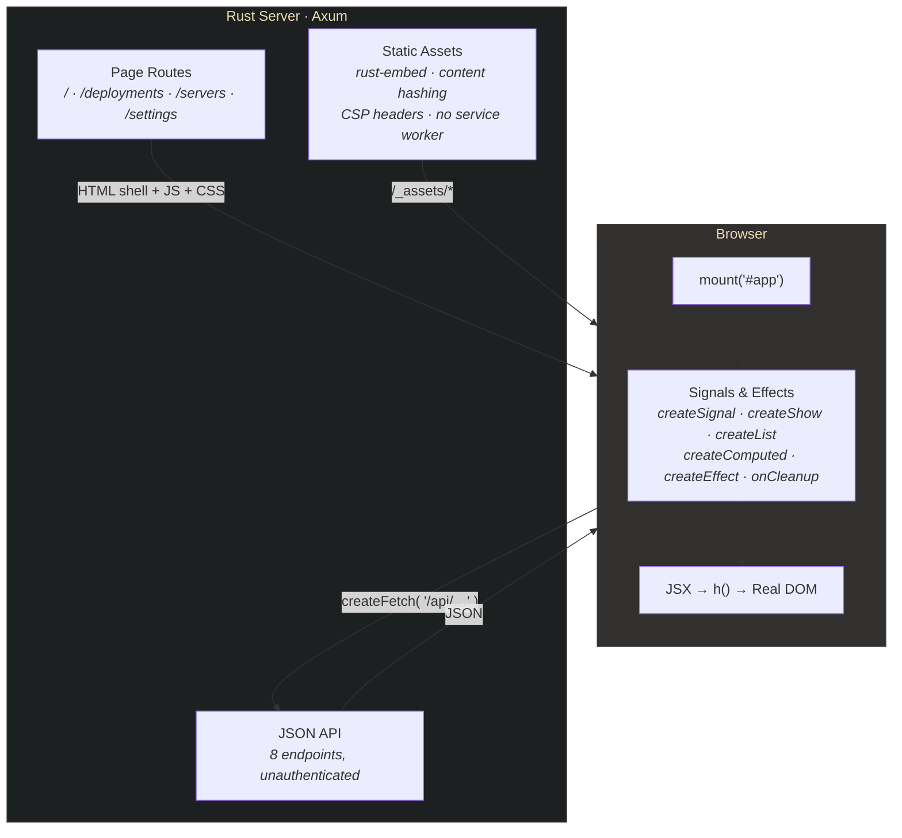

# FormaOps Dashboard

A DevOps admin panel built with the [Forma Stack](https://getforma.dev) — Rust +
FormaJS + Tailwind CSS. Everything interactive here — the SVG chart, the data
tables, the sidebar, the command palette — is built from FormaJS signals against
the real DOM. No React, no virtual DOM.

## Quick Start

```bash
# Build the frontend
cd admin && npm ci && npm run build && cd ..

# Start the Rust server
cargo run
```

Open [http://localhost:3000](http://localhost:3000). Set `FORMA_PORT` to choose
another port (0 asks the OS to assign one); `FORMA_LISTENING` reports the bound
address. Loopback remains the default.

`admin/package-lock.json` and `Cargo.lock` pin the versions this template was
built and tested with. `npm ci` installs exactly those and never rewrites the
lockfile; pnpm, yarn and bun do not read `package-lock.json` and resolve the
ranges in `package.json` afresh. `Cargo.toml` declares `rust-version = "1.85"`
with `resolver = "3"`, so a later `cargo update` only picks crates that still
build on Rust 1.85. Commit both lockfiles.

**`npm ci` reports 4 high advisories, all one chain, and there is nothing to
fix yet.** As of 2026-10-14, `admin/package-lock.json` resolves
`@tailwindcss/cli` 4.3.3 → `@parcel/watcher` 2.5.1 → `micromatch` 4.0.8 →
`braces` 3.0.3, and `braces` 3.0.3, the latest release (May 2024), is inside
[GHSA-vfj7-8cjw-p6xm](https://github.com/advisories/GHSA-vfj7-8cjw-p6xm)
(`<=3.0.3`: a stack-exhaustion denial of service through deeply nested brace
patterns; no fixed version on npm). `@parcel/watcher` is the file watcher
behind `@tailwindcss/cli --watch`, loaded only in that mode, which
`@getforma/build` never uses: it runs the Tailwind CLI once per build, so the
watcher never runs here, and nothing of it is in the built assets or the
server. `npm audit fix` changes nothing, because
`@tailwindcss/cli` 4.3.1 and later pin `@parcel/watcher` to exactly 2.5.1. The
chain clears when `@tailwindcss/cli` moves to `@parcel/watcher` 2.6.0, which
replaced `micromatch` with `picomatch`, or when `braces` publishes a fix;
`npm update @tailwindcss/cli` in `admin/` then picks it up.

## Security before you deploy this

The server binds to `127.0.0.1` (localhost only). To expose it, opt in:

```bash
FORMA_HOST=0.0.0.0 cargo run
```

**The `/api/*` routes have no authentication.** Every one of the eight endpoints
below answers any request that reaches the process. Today they return the mock
data in `src/data.rs`, so exposure costs you nothing — the moment you point them
at a real database, put authentication in front of them. The server prints a
warning at startup whenever `FORMA_HOST` is set to a non-loopback address.

**No service worker.** `main.rs` configures forma-server's worker setting off
(`sw::ServiceWorker::off()`), so no page registers one, and `/sw.js` serves
forma-server's retiring worker: a browser that installed a Forma worker on this
origin before deletes its caches and unregisters it on its next visit. The
worker is opt-in, per application; see `forma_server::sw` before turning it on.

**Trusted Types are enforced.** Page responses include both
`require-trusted-types-for 'script'` and the named `forma forma-runtime`
policies in their normal CSP. External scripts and styles carry their
manifest SHA-384 integrity and `crossorigin="anonymous"`. Keep the returned
`PageResponse` intact so its fresh nonce and `Cache-Control: no-store` travel
with the HTML.

---

## What's Inside

### Pages

| Page | URL | What It Shows |
|------|-----|---------------|
| **Overview** | `/` and `/overview` | Stat cards, interactive SVG chart, service status grid, recent deployments, active incidents |
| **Deployments** | `/deployments` | 4 stat cards, searchable deployment history table with 12 rows, status/environment badges |
| **Servers** | `/servers` | Server fleet grid with status filter tabs (All/Online/Degraded/Offline), CPU/Memory/Disk progress bars |
| **Settings** | `/settings` | Placeholder card — yours to fill in |

### Features

- **Client-side routing** via `createSignal` + `createShow` + History API (no router library)
- **Command palette** (Cmd+K / Ctrl+K) with page search and navigation
- **Interactive SVG chart** — hand-rolled, hover tooltip with success/error counts
- **Deployment table search** — reactive filtering across all columns
- **Server fleet filtering** — `createComputed` filter with tab counts
- **Loading skeletons** and **error states** on every page
- **Collapsible sidebar** with grouped navigation and SVG icons
- **Dark theme** — Gruvbox palette with a neon green (#39FF14) accent
- **16 Playwright E2E tests** — navigation, data rendering, filtering, API validation, console-error check

### API Endpoints

| Route | Response | Description |
|-------|----------|-------------|
| `GET /api/metrics` | `Metric[]` | Overview stat cards (uptime, latency, load, deploy rate) |
| `GET /api/deployment-stats` | `DeploymentStats` | Deployments page stat cards |
| `GET /api/deployments` | `Deployment[]` | 12 deployment records |
| `GET /api/servers` | `Server[]` | 8 servers with CPU/memory/disk metrics |
| `GET /api/services` | `Service[]` | 8 services with health status and latency |
| `GET /api/service-summary` | `ServiceStatusSummary` | Aggregate counts (healthy/degraded/down) |
| `GET /api/request-volume` | `RequestVolumePoint[]` | 24 hourly data points for the SVG chart |
| `GET /api/incidents` | `Incident[]` | 5 incidents with severity and status |

---

## Layout

```
src/
├── main.rs                    Axum server — page routes + 8 API routes
└── data.rs                    Structs and mock data (replace with your DB)

admin/src/
├── app.tsx                    Layout, Sidebar, TopBar, routing, command palette
├── pages/                     OverviewPage, DeploymentsPage, ServersPage, SettingsPage
├── components/                Icon, icons.ts, StatCard, StatusBadge, ProgressBar, UserAvatar
└── styles/dashboard.css       Tailwind v4 @theme + custom animations
```



---

## Browser rendering by declaration

Every dashboard route is explicitly Browser: `build.ts` declares `ssr: false`,
`main.rs` uses `render_browser_shell`, and no `build:ssr` command is offered.
The client loads the existing mock `/api/*` data and renders the page. The
server finalizes its route registry before listening, so adding an unbound SSR
route refuses startup rather than silently serving a shell.

An SSR migration would define a page's TypeScript props, supply matching Rust
`PageProps`, bind its `PageHandle<Props>` once, and render those values per
request. The compiler reads source; it cannot execute a browser fetch to
obtain server data. The build scripts enable strict mode, so unsupported SSR
constructs fail with code, file and location. Silent placeholder output is
not the current template contract.

The minimal template demonstrates declared props and actual FMIR rendering.
It still mounts the whole browser page with a matching initial count; island
state adoption remains a separate migration. See the maintained
[rendering guide](https://github.com/getforma-dev/forma/blob/main/packages/create-app/docs/RENDERING-PHASES.md)
and [compiler contract](https://github.com/getforma-dev/forma/blob/main/packages/compiler/README.md).

The old compiler 0.2/0.3 dashboard measurements describe the 2026-08-06 build,
not today's compiler. Their original table and interpretation are preserved
in the [dated source archive](https://github.com/getforma-dev/forma/blob/main/docs/archive/2026-10-15-template-slice1/packages/create-app/templates/dashboard/README.md).

---

## FormaJS Patterns Used

Full API documentation lives at [getforma.dev/docs](https://getforma.dev/docs);
this is a map of where each primitive shows up in this codebase.

| Primitive | Where | What it does here |
|---|---|---|
| `createSignal` | `app.tsx`, every page | Current page, sidebar collapse, search text, filter tab |
| `createShow` | `app.tsx`, every page | The router itself, plus loading/error branches |
| `createList` | `DeploymentsPage`, `ServersPage` | Keyed table rows and server cards |
| `createComputed` | `ServersPage` | Filtered fleet + per-status counts |
| `createEffect` | `app.tsx`, `OverviewPage` | URL sync via History API; imperative SVG hover layer |
| `onCleanup` | `app.tsx` | Removes the `popstate` and `keydown` listeners |
| `createFetch` | every page | Loads `/api/*` with `.data()` / `.loading()` / `.error()` |

Two things that catch people out:

- **`createFetch` is imported from `@getforma/core/http`**, not the main entry.
  The core bundle contains no network code.
- **Reactive props are functions.** `class={() => ...}` re-runs on signal change;
  `class={...}` is evaluated once.

### Styling

Tailwind CSS v4 with a `@theme` block in `admin/src/styles/dashboard.css` (v4
has no `tailwind.config.js`), which is what gives you `bg-gruvbox-bg-soft`,
`text-forma-green` and friends. Custom CSS is limited to the neon glow,
`@keyframes`, and scrollbar styling.

Note how the CSP the server sends treats styles. `style-src` carries a nonce
and no `unsafe-inline`, so inline `<style>` blocks and third-party stylesheets
are refused. A separate `style-src-attr 'unsafe-inline'` permits `style="..."`
attributes specifically, which is what lets server-rendered style attributes
through. The `style={...}` props in this template do not rely on that: `h()`
applies them through the CSSOM at runtime, which CSP does not cover at all.

---

## Customising

- **Real data:** edit `src/data.rs` — replace the hardcoded `Vec<...>` returns
  with your queries. The structs are the API contract, and `serde` derives the
  JSON.
- **A new page:** add `admin/src/pages/MyPage.tsx`, a `createShow` branch in
  `app.tsx`, entries in `PAGE_META` / `PALETTE_ITEMS` / the sidebar, and a route
  in `main.rs` (page routes all render the same shell — the client routes).
- **Icons:** copy path data from [Iconify Lucide](https://icon-sets.iconify.design/lucide/)
  into `components/icons.ts`, then `<Icon d={ICON_NAME} />`.

## Tests

```bash
cd admin && npx playwright install chromium   # first run only
npm test
```

16 tests. `playwright.config.ts` starts the server for you with
`cd .. && cargo run`, so build the frontend first.

## Tech Stack

| Layer | Technology |
|-------|-----------|
| Server | Rust + Axum, `forma-server` for page rendering, assets and CSP |
| Frontend | FormaJS (`@getforma/core`) — signals, JSX via `h()` |
| Styling | Tailwind CSS v4 |
| Build | `@getforma/build` + esbuild — bundling, hashing, compression, manifest |
| Assets | `rust-embed` (read from disk in debug builds, embedded in release) |
| Testing | Playwright |

## Part of the Forma Stack

- [@getforma/core](https://www.npmjs.com/package/@getforma/core) — reactive DOM library
- [@getforma/build](https://www.npmjs.com/package/@getforma/build) — build pipeline
- [@getforma/compiler](https://www.npmjs.com/package/@getforma/compiler) — FMIR compiler (used by the `minimal` template's SSR build)
- [forma-server](https://crates.io/crates/forma-server) — Rust page rendering, assets, CSP
- [forma-ir](https://crates.io/crates/forma-ir) — FMIR parser and HTML walker
